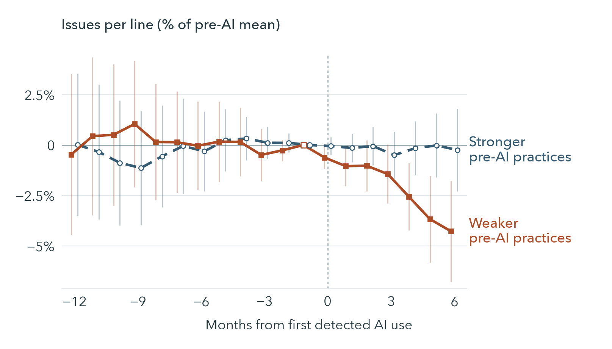

## Working Papers

### [AI and Technical Debt: Evidence From 4 Billion Lines of Code](https://papers.ssrn.com/sol3/papers.cfm?abstract_id=7685808){.research-paper-link}

With João Dimas and Labros Pnevmatikos

:::: {.research-paper-body}

::: {.research-paper-chart}

:::

::: {.research-paper-copy}
Does writing code with AI make software harder to maintain? After we first detected agentic AI use, comparable firms’ public software projects saw faster codebase growth and declines in both code issues and estimated repair costs per line. Quality gains came in projects that started with weaker development discipline, including less established routines for testing and reviewing code. Their development practices improved after detection.
:::

::::

::: {.research-paper-support}
[Supported by Sonar Research Program](https://www.sonarsource.com/research-grant/){.research-paper-link}
:::
